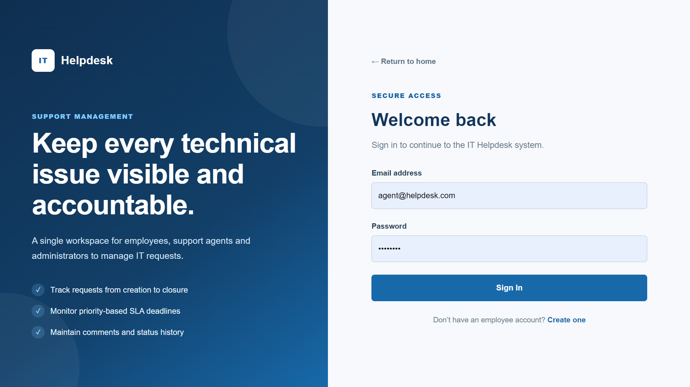
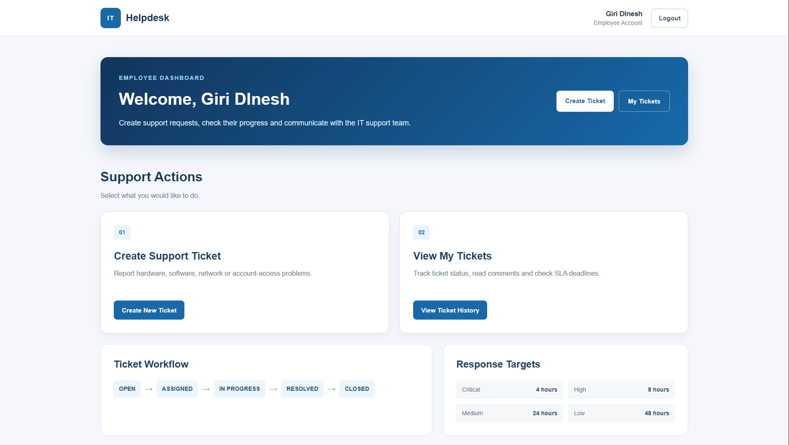
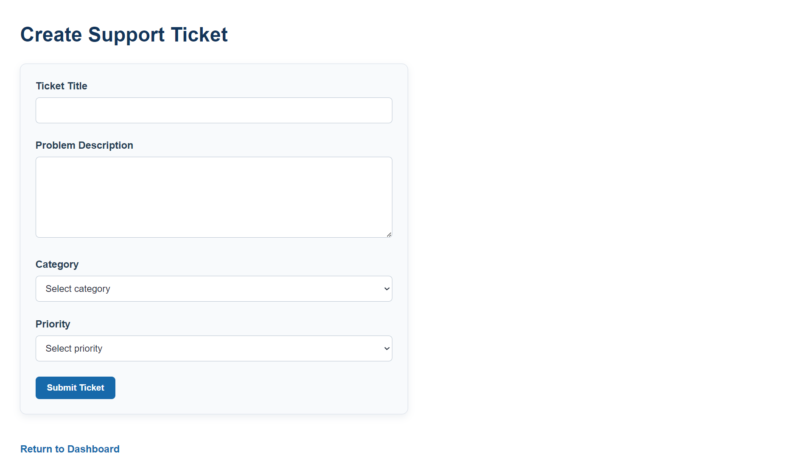
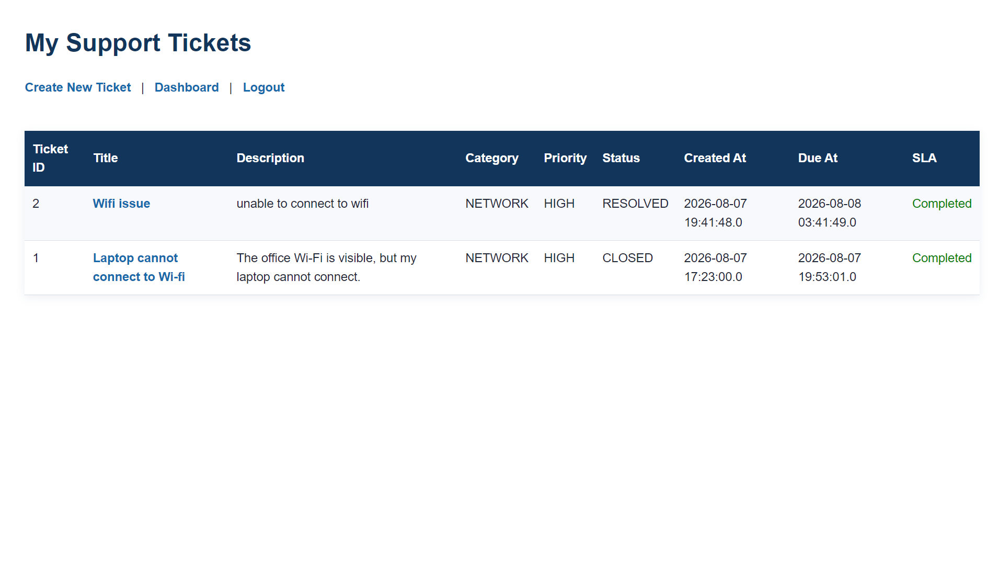
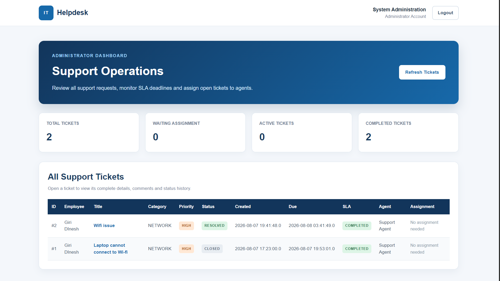
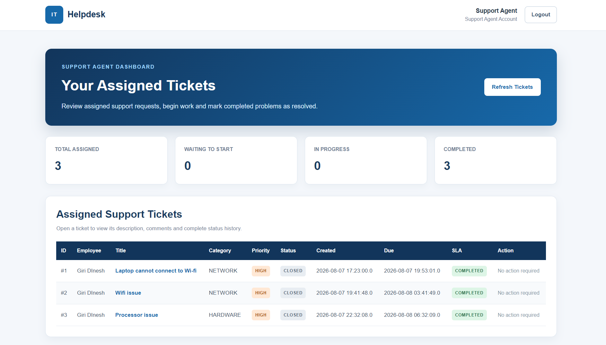

# IT Helpdesk Ticketing System

A full-stack Java web application for reporting, assigning, tracking, and resolving technical support tickets.

The application demonstrates Java OOP, Servlets, JSP, JDBC, and MySQL using a layered architecture. It provides separate workflows for employees, support agents, and administrators.

## Application Screenshots

### Login Page



### Employee Dashboard



### Create Ticket



### My Tickets



### Administrator Dashboard



### Agent Dashboard



## Features

### Employee

- Create an employee account
- Log in using registered credentials
- Create technical support tickets
- Select ticket category and priority
- View personal ticket history
- Monitor ticket status and SLA
- Add comments to accessible tickets
- Close tickets after resolution

### Support Agent

- View assigned tickets
- Access ticket details and employee comments
- Start work on assigned tickets
- Mark completed work as resolved
- Add comments to assigned tickets

### Administrator

- View all support tickets
- View registered support agents
- Assign open tickets to agents
- Monitor ticket priority, status, and SLA
- Access ticket comments and status history

## Ticket Workflow

```text
OPEN
  ↓
ASSIGNED
  ↓
IN_PROGRESS
  ↓
RESOLVED
  ↓
CLOSED
```

- Administrators assign open tickets.
- Support agents move tickets from `ASSIGNED` to `IN_PROGRESS`.
- Support agents move completed tickets to `RESOLVED`.
- Employees close their resolved tickets.

## SLA Rules

| Priority | Resolution Time |
|----------|----------------:|
| Critical | 4 hours         |
| High     | 8 hours         |
| Medium   | 24 hours        |
| Low      | 48 hours        |

The application calculates the due time automatically when a ticket is created.

## Technology Stack

### Backend

- Java 8
- Java Servlets
- JDBC
- Java OOP

### Frontend

- JSP
- HTML5
- CSS3

### Database

- MySQL 8

### Build and Deployment

- Maven
- Apache Tomcat 9
- Eclipse IDE

## Application Architecture

```text
Browser
   ↓
JSP / HTML / CSS
   ↓
Servlet
   ↓
DAO using JDBC
   ↓
MySQL Database
```

- Model classes represent users, tickets, comments, and history.
- Servlets process browser requests and control navigation.
- DAO classes perform database operations.
- JSP pages display application information.
- HTTP sessions maintain logged-in users.
- MySQL stores users, tickets, comments, and status history.

## Project Structure

```text
HelpdeskTicketSystem
├── database
│   ├── schema.sql
│   └── sample-data.sql
├── screenshots
│   ├── login-page.png
│   ├── employee-dashboard.png
│   ├── create-ticket.png
│   ├── my-tickets.png
│   ├── admin-dashboard.png
│   └── agent-dashboard.png
├── src/main/java/com/dishapal/helpdesk
│   ├── config
│   │   └── DBConnection.java
│   ├── dao
│   │   ├── CommentDAO.java
│   │   ├── HistoryDAO.java
│   │   ├── TicketClosureDAO.java
│   │   ├── TicketDAO.java
│   │   ├── TicketDetailsDAO.java
│   │   └── UserDAO.java
│   ├── model
│   │   ├── Ticket.java
│   │   ├── TicketComment.java
│   │   ├── TicketHistory.java
│   │   └── User.java
│   ├── servlet
│   │   ├── AddCommentServlet.java
│   │   ├── AdminDashboardServlet.java
│   │   ├── AgentDashboardServlet.java
│   │   ├── AssignTicketServlet.java
│   │   ├── CloseTicketServlet.java
│   │   ├── CreateTicketServlet.java
│   │   ├── DashboardServlet.java
│   │   ├── LoginServlet.java
│   │   ├── LogoutServlet.java
│   │   ├── MyTicketsServlet.java
│   │   ├── RegisterServlet.java
│   │   ├── TicketDetailsServlet.java
│   │   └── UpdateTicketStatusServlet.java
│   └── util
│       ├── HtmlUtil.java
│       └── PasswordUtil.java
├── src/main/resources
│   └── db.properties.example
├── src/main/webapp
│   ├── css
│   │   ├── dashboard-style.css
│   │   └── style.css
│   ├── WEB-INF
│   │   └── web.xml
│   ├── admin-dashboard.jsp
│   ├── agent-dashboard.jsp
│   ├── create-ticket.jsp
│   ├── dashboard.jsp
│   ├── index.jsp
│   ├── login.jsp
│   ├── my-tickets.jsp
│   ├── register.jsp
│   └── ticket-details.jsp
├── .gitignore
├── pom.xml
└── README.md
```

## Database Tables

- `users` stores employee, agent, and administrator accounts.
- `tickets` stores technical support requests and SLA deadlines.
- `ticket_comments` stores ticket conversations.
- `ticket_history` stores every ticket status change.

## Running the Application

### Requirements

Install the following software:

- JDK 8 or later
- MySQL 8
- Maven
- Apache Tomcat 9
- Eclipse IDE or another Java IDE

### Database Setup

1. Open MySQL Workbench.
2. Execute `database/schema.sql`.
3. Execute `database/sample-data.sql`.
4. Refresh the MySQL schemas.

### Application Configuration

1. Open:

```text
src/main/resources
```

2. Copy `db.properties.example`.
3. Rename the copied file to `db.properties`.
4. Add your local MySQL username and password:

```properties
db.url=jdbc:mysql://localhost:3306/helpdesk_system?useSSL=false&serverTimezone=Asia/Kolkata
db.username=root
db.password=YOUR_MYSQL_PASSWORD
```

The real `db.properties` file is ignored by Git to protect local database credentials.

### Eclipse and Tomcat Setup

1. Import the project as an existing Maven project.
2. Update the Maven project.
3. Configure Apache Tomcat 9.
4. Add the project to the Tomcat server.
5. Start MySQL.
6. Start Tomcat.
7. Open:

```text
http://localhost:8080/helpdesk-ticket-system/
```

## Sample Accounts

### Administrator

```text
Email: admin@helpdesk.com
Password: admin123
```

### Support Agent

```text
Email: agent@helpdesk.com
Password: agent123
```

### Employee (Disha Pal)

```text
Full Name: Disha Pal
Email: disha@helpdesk.com
Password: disha123
```

Employees can create their own accounts using the registration page.

## Technical Highlights

- DAO pattern separates SQL logic from request-handling logic.
- JDBC prepared statements reduce SQL injection risk.
- Database transactions protect assignment and status updates.
- Role validation restricts employee, agent, and administrator operations.
- Ticket ownership controls access to ticket details.
- HTML escaping protects user-created text when displayed.
- HTTP sessions maintain authentication.
- Ticket history provides an audit trail.
- Automatic SLA deadlines are based on priority.
- Passwords are not stored as plain text.

## Password Hashing Note

This learning project uses SHA-256 hashing to avoid storing plain-text passwords.

For a production application, password hashing should be upgraded to BCrypt, PBKDF2, or Argon2 with a unique salt for every password.

## Future Improvements

- Search and filter tickets
- Ticket reopening
- Email notifications
- File attachments
- Pagination
- Connection pooling
- BCrypt or Argon2 password hashing
- Automated testing

## Author

**Disha Pal**